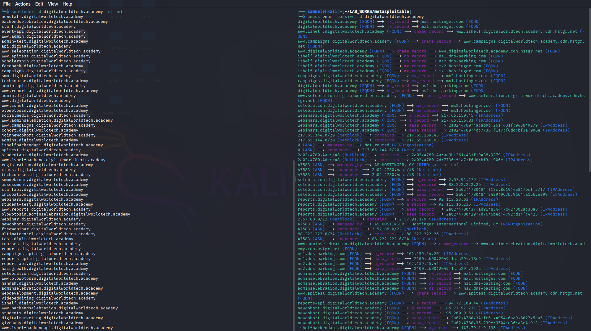

# Ethical Hacking
## Course Module Overview

**Prerequisites:** Basic networking (TCP/IP, DNS, HTTP), Linux command-line familiarity, and a foundational understanding of the Cyber Kill Chain or PTES methodology.  

**Learning Objectives:** By the end of this module, you will be able to:

1.  Explain the strategic purpose of reconnaissance within the penetration testing lifecycle.
2.  Differentiate between passive and active reconnaissance in terms of detection risk, legal exposure, and intelligence yield.
3.  Execute industry-standard tools at each stage of reconnaissance against an authorized lab target.
4.  Interpret raw reconnaissance output and translate it into actionable findings for an assessment report.
5.  Apply ethical and legal boundaries (Rules of Engagement) to every reconnaissance activity.

**Materials Required:** Kali Linux (attacker VM), a deliberately vulnerable target VM (e.g., Metasploitable 2, OWASP Broken Web Apps, or a self-hosted BIND9 zone for DNS exercises), internet access for passive OSINT (only against fictional or self-owned domains), and a reporting template.

## Theoretical Foundation

Reconnaissance is the first phase of the penetration testing execution standard (PTES) and the Cyber Kill Chain. Its purpose is to map the **attack surface**—the sum of all exposed systems, services, technologies, and human assets—before any exploitation is attempted. The quality of reconnaissance directly determines the success of every subsequent phase: an assessor who misses a forgotten subdomain, a leaked credential, or an outdated service version will build an incomplete threat model and likely miss the most viable attack path.

Reconnaissance is conventionally divided into two macro-phases, though in practice the workflow is iterative:

| Dimension | Passive Reconnaissance | Active Reconnaissance |
| :--- | :--- | :--- |
| **Direct interaction with target** | None | Yes (packets are sent directly to target systems) |
| **Detection risk** | Negligible (third-party sources only) | High (logs, IDS/IPS, SIEM alerts) |
| **Legal exposure** | Low (public data), but still governed by scope | High if performed outside a signed authorization |
| **Primary yield** | Organizational profile, infrastructure map, human intelligence | Technical fingerprinting, open ports, service versions, potential vulnerabilities |
| **Typical tools** | WHOIS, DNS query tools (dig, host), crt.sh, theHarvester, Shodan, Google dorking, Wayback Machine | Nmap, Masscan, Netcat, Nikto, Nessus, Gobuster, DNSRecon |

The **reconnaissance methodology** often follows a phased progression: **Scope/Rules of Engagement → Passive enumeration → Normalization/validation → Active scanning → Web and infrastructure enumeration → Triage → Validation**. This module mirrors that progression, with each practical stage building on the previous one.

## Module 1: Passive Reconnaissance — "Leave No Trace"

### Theory

Passive reconnaissance collects information without directly touching the target's infrastructure. The assessor relies entirely on **Open Source Intelligence (OSINT)** and third-party data brokers. This phase is safe from a detection standpoint but requires disciplined note-keeping: every discovered hostname, IP address, email address, and technology must be recorded because these artifacts become the seed list for active scanning.

### Tools, Commands, and Expected Findings

#### 1.1 Domain Registration and Ownership (WHOIS)

**Purpose:** Identify the registrant organization, administrative contacts, name servers, and registration dates. Historical WHOIS data can reveal organizational changes or infrastructure migrations.

**Command (Kali Linux):**
```bash
whois target.com
```

**Expected findings:**
- Registrant organization name and address (often redacted by privacy services, but the registrar and name servers remain visible).
- Authoritative name servers (critical for later DNS enumeration).
- Creation and expiration dates (indicate organizational maturity).
- Abuse contact email (useful for social engineering vector mapping, though never to be exploited outside scope).
<!-- 
**Instructor note:** If WHOIS is privacy-protected, pivot to **Reverse WHOIS** tools (e.g., `whoisxmlapi` or `viewdns.info/reversewhois`) to find other domains registered by the same entity. -->

#### 1.2 DNS Intelligence (Passive DNS and Certificate Transparency)

**Purpose:** Discover subdomains and internal hostnames without sending DNS queries to the target's own name servers. Certificate Transparency (CT) logs are a goldmine: every SSL/TLS certificate issued is publicly logged, often revealing subdomains the organization never intended to expose.

**Commands:**
```bash
# Certificate Transparency via crt.sh
curl -s "https://crt.sh/?q=%25.target.com&output=json" | jq -r '.[].name_value' | sort -u

# Passive subdomain enumeration with Subfinder
subfinder -d target.com -silent

# Passive enumeration with Amass
amass enum -passive -d digitalw0rldtech.academy
```


**Expected findings:**
- Subdomains such as `vpn.target.com`, `portal.target.com`, `dev.target.com`, `mail.target.com`, `catalog.target.com`.
- Internal hostnames that leak naming conventions (e.g., `dc01.corp.target.com`).
- Wildcard certificates that reveal multiple services bundled under a single certificate.

[subfinder output](output/subfinder_output.txt),
[Amass output](output/amass_output.txt)

<!-- **Instructor scenario (Passive DNS):** "You are assessing a fictional retail company, `meridianfreight.test`. Run `subfinder` and CT log queries. Expected finding: at least 9 distinct subdomains, including a development portal that returns a different technology stack than the production site. Record every hostname and resolve it in the next phase." -->

#### 1.3 Search Engine Dorking (Google Hacking)

**Purpose:** Use advanced search operators to find indexed sensitive files, exposed login panels, configuration leaks, and API keys that the organization may not realize are public.

**Example dorks and expected findings:**

| Dork | Purpose | Expected finding |
| :--- | :--- | :--- |
| `site:target.com filetype:pdf` | Find indexed documents | Internal policy documents, network diagrams, or vendor contracts |
| `site:target.com inurl:admin` | Locate admin panels | Login pages for CMS, Jenkins, phpMyAdmin, or custom portals |
| `site:target.com intitle:"index of"` | Find directory listings | Open directories containing backups, logs, or source code |
| `site:target.com ext:sql OR ext:db OR ext:backup` | Locate exposed database files | Downloadable SQL dumps or configuration backups |
| `site:*.target.com "api_key" OR "api_secret"` | Find leaked credentials | Hardcoded API keys in JavaScript or HTML comments |
<!-- 
**Instructor note:** Google dorking is entirely passive with respect to the target's servers, but the assessor must never download or interact with sensitive files found through dorking outside a signed authorization. -->

#### 1.4 Technology Stack Fingerprinting (Passive)

**Purpose:** Identify the technologies, frameworks, and third-party services in use without sending probing traffic to the target.

**Tools:**
- **Wappalyzer** (browser extension or CLI): Detects CMS, JavaScript libraries, analytics, and server software.
- **BuiltWith**: Reveals hosting providers, CDNs, and marketing automation platforms.
- **WhatWeb**: Command-line fingerprinting of web technologies.

```bash
whatweb -a 4 target.com
```

**Expected findings:**
- Web server type and version (e.g., `nginx 1.18.0`, `Apache httpd 2.4.52`).
- CMS and plugins (e.g., WordPress 6.x with a vulnerable plugin).
- JavaScript frameworks (React, Angular, jQuery versions).
- Third-party services (Cloudflare, AWS S3 buckets, Google Analytics IDs).
<!-- 
**Instructor scenario (Technology stack):** "Using `whatweb -a 3 https://target.com`, you identify that the target runs Apache httpd 2.4.52. A passive Shodan query for that IP reveals CVE-2022-22720 (CVSS 9.8) associated with that version. This finding is not yet confirmed—it must be validated in the active phase, but it immediately prioritizes the web server as a high-interest target". -->

#### 1.5 Human Intelligence and Email Harvesting

**Purpose:** Map the human attack surface—employee names, email address formats, job roles, and technology mentions in job postings—for social engineering risk assessment and credential-stuffing exposure analysis.

**Tools:**
- **theHarvester**: Aggregates emails, subdomains, hosts, and employee names from public sources.
- **Hunter.io**: Discovers email address patterns and verifies deliverability.
- **LinkedIn and job postings**: Reveal internal tooling (e.g., "experience with Palo Alto firewalls and AWS").

**Command:**
```bash
theHarvester -d target.com -b google,linkedin -l 500
```

**Expected findings:**
- Email format: `firstname.lastname@target.com`.
- Key personnel: IT administrators, network engineers, developers, and executives.
- Technology mentions in job listings that confirm the internal stack (e.g., "must have experience with Cisco ASA and VMware").

#### 1.6 Credential Leak Analysis

**Purpose:** Determine whether organizational credentials have appeared in known data breaches, which would indicate a direct entry point for credential-stuffing or password-spraying attacks.

**Tool:** HaveIBeenPwned (API or web interface).
    `https://haveibeenpwned.com/`

**Expected findings:**
- Domain email addresses appearing in breaches (e.g., LinkedIn 2012, Adobe 2013, Collection #1).
- If credentials are found, the finding is **critical** and must be reported immediately with a recommendation for forced password resets and MFA enforcement.

### Module 1 Practical Exercise: Passive Footprint Report

**Scenario:** You are conducting a passive reconnaissance engagement against a fictional target domain provided by the instructor (e.g., `meridianfreight.test` or a self-hosted BIND9 zone). **Do not send any packets directly to the target's IP addresses.**

**Tasks:**
1.  Run WHOIS and record the registrar, name servers, and registration dates.
2.  Execute at least two subdomain enumeration tools (e.g., `subfinder` and `amass enum -passive`) and produce a deduplicated list of discovered hostnames.
3.  Query `crt.sh` for certificate transparency entries and cross-reference with your subdomain list.
4.  Perform three Google dorks against the target domain and document any sensitive indexed content.
5.  Use `whatweb` or Wappalyzer to identify the technology stack of the main domain.
6.  Run `theHarvester` and compile a list of employee email addresses and formats.
7.  Query HaveIBeenPwned for the target domain and record any breach exposure.

**Deliverable:** A passive footprint report containing a host inventory table (hostname, IP if resolved, technology, source of discovery) and a risk-ranked list of the top three passive findings. **Expected minimum findings:** at least 5 subdomains, 1 technology version leak, and 1 sensitive indexed artifact (or a documented absence of exposure).

## Module 2: Active Reconnaissance — "Direct Interrogation"

### Theory

Active reconnaissance involves sending packets directly to the target's systems to elicit responses that reveal open ports, running services, operating system details, and configuration weaknesses. This phase carries a high detection risk and must only be performed within a signed **Rules of Engagement (RoE)** or against a self-owned lab environment. The outputs of active scanning directly seed the vulnerability discovery phase: every open port is a potential service to enumerate, and every service version is a potential CVE to investigate.

### Tools, Commands, and Expected Findings

#### 2.1 Host Discovery (Ping Sweep)

**Purpose:** Identify live hosts on a subnet before performing port scans, reducing scan time and noise.

**Command:**
```bash
nmap -sn 192.168.0.0/24
```

**Expected findings:**
- A list of live hosts with latency measurements.
- In a `/24` lab subnet, expect approximately 3–7 live hosts (the target VM, the attacker VM, the gateway, and any supporting services).
- If the target blocks ICMP, use ARP discovery on the local subnet (`nmap -PR 192.168.0.0/24`) or TCP SYN ping (`nmap -PS22,80,443 192.168.0.0/24`).

#### 2.2 Port Scanning and Service Version Detection

**Purpose:** Discover open TCP/UDP ports and fingerprint the exact software and version listening on each port. This is the single most important active reconnaissance step because service versions map directly to known vulnerabilities.

**Commands (progressive depth):**

```bash
# Fast scan of top 100 ports with version detection
nmap -F -sV 192.168.0.4

# Full TCP port scan (all 65,535 ports) with aggressive timing
nmap -p- -T4 --min-rate 1000 192.168.0.4

# Service and default script scan on discovered web ports
nmap -sV -sC -p 22,80,443,8080 192.168.0.4

# UDP scan of top 20 ports (slower; use sparingly)
nmap -sU --top-ports 20 192.168.0.4

# OS fingerprinting
nmap -O 192.168.0.4

# Agressive scan, combines most of the top flags you'll ever need
namp -A -T4 -p- 192.168.0.4 -O nmap_scan.txt
```

**Expected findings:**

| Port | Service | Version (example) | Significance |
| :--- | :--- | :--- | :--- |
| 21/tcp | FTP | vsftpd 2.3.4 | Known backdoor vulnerability (CVE-2011-2523) |
| 22/tcp | SSH | OpenSSH 4.7p1 | Old version; weak crypto algorithms may be enabled |
| 23/tcp | Telnet | Linux telnetd | Cleartext authentication protocol |
| 25/tcp | SMTP | Postfix smtpd | Potential open relay or user enumeration |
| 80/tcp | HTTP | Apache httpd 2.2.8 | Outdated; multiple known CVEs |
| 139/445 | SMB | Samba 3.x | Known RCE vulnerabilities (e.g., CVE-2007-2447) |
| 3306/tcp | MySQL | MySQL 5.0.51a | Weak authentication or default credentials possible |
| 5432/tcp | PostgreSQL | PostgreSQL 8.3 | Outdated database service |

<!-- **Instructor note:** The exact service versions depend on the target VM. The pedagogical objective is not memorizing CVEs but teaching learners to **map version banners to vulnerability databases (NVD, Exploit-DB)** in the next phase. Emphasize the difference between `-sS` (SYN/half-open, stealthier) and `-sT` (full connect, more likely to be logged). -->

#### 2.3 DNS Enumeration and Zone Transfer Testing

**Purpose:** Interrogate the target's DNS infrastructure to discover additional hosts, mail servers, service records, and—critically—whether the name server is misconfigured to allow an unauthorized **zone transfer (AXFR)**. A successful zone transfer leaks the entire DNS zone file, including internal hostnames never meant for external visibility.

**Commands:**

```bash
# Query all common DNS record types
dig target.com ANY +noall +answer

# Specific record queries
dig target.com MX +short
dig target.com TXT +short
dig target.com NS +short

# Attempt zone transfer against each discovered name server
dig axfr @ns1.target.com target.com

# DNSRecon for structured enumeration
dnsrecon -d target.com -t std

# Subdomain brute forcing (active)
puredns bruteforce wordlist.txt target.com -r resolvers.txt
```

**Expected findings (successful AXFR against `zonetransfer.me`):**
- A complete inventory of A, AAAA, CNAME, MX, NS, SRV, and TXT records.
- Internal hostnames such as `intranet.target.com`, `dc01.target.com`, `backup.target.com`.
- SRV records revealing Active Directory services (`_kerberos._tcp`, `_ldap._tcp`).
- SPF and DMARC TXT records that disclose email providers and cloud services.
<!-- 
**Instructor scenario (Zone transfer):** "Attempt `dig axfr @ns1.target.com target.com`. If the transfer succeeds, you have obtained the complete host inventory without scanning a single IP address. Document every hostname, resolve it to an IP, and cross-reference with your Nmap output. The zone transfer finding is a **high-severity misconfiguration** and must be reported with a remediation recommendation to restrict AXFR to authorized secondary name servers using TSIG authentication". -->

#### 2.4 Banner Grabbing

**Purpose:** Connect directly to an open port and read the service banner, which often reveals the exact software name, version, and sometimes internal hostnames or configuration details. Banner grabbing is a lightweight complement to Nmap's `-sV` detection and is useful for services that Nmap may misidentify.

**Commands:**

```bash
# HTTP banner grab
echo -e "GET / HTTP/1.0\r\n\r\n" | nc -v 192.168.0.4 80

# SMTP banner grab
echo "QUIT" | nc -v 192.168.0.4 25

# FTP banner grab
nc -v 192.168.0.4 21

# SSH banner grab
nc -v 192.168.0.4 22

# Using Nmap NSE banner script
nmap --script=banner -p 21,22,25,80 192.168.0.4
```

**Expected findings:**
- HTTP response headers revealing `Server: Apache/2.2.8 (Ubuntu) DAV/2`.
- SMTP banner: `220 metasploitable.localdomain ESMTP Postfix (Ubuntu)`.
- FTP banner: `220 (vsFTPd 2.3.4)`.
- SSH banner: `SSH-2.0-OpenSSH_4.7p1 Debian-8ubuntu1`.
<!-- 
**Instructor note:** Banner grabbing is noisy—the connection appears in service logs. In a real engagement, coordinate timing with the client's SOC to avoid false alarms. In the lab, use it to teach learners that a single `nc` command can yield the same version intelligence as an Nmap script, reinforcing the principle that reconnaissance is about **understanding the protocol**, not just running tools. -->

#### 2.5 Web Server and Application Scanning (Initial)

**Purpose:** Perform a lightweight automated scan of web servers to identify missing security headers, dangerous HTTP methods, and default files before moving to content discovery.

**Commands:**

```bash
# Nikto web server scan
nikto -h http://192.168.0.4

# Nmap NSE HTTP headers and methods
nmap --script=http-headers,http-methods -p 80 192.168.0.4
```

**Expected findings:**
- Missing `X-Frame-Options` header (clickjacking risk).
- `TRACE` method enabled (Cross-Site Tracing potential).
- Default `phpinfo()` page exposed.
- Directory indexing enabled on `/icons/` or `/docs/`.

### Module 2 Practical Exercise: Active Reconnaissance Lab

**Scenario:** You have completed passive reconnaissance against `192.168.0.4` (Metasploitable 2) and identified it as a high-value target. Now perform active reconnaissance within the authorized lab scope.

**Tasks:**
1.  Perform a ping sweep of the lab subnet and identify all live hosts.
2.  Run a full TCP port scan (`-p-`) on the target and save the output in three formats (`-oA`).
3.  Perform service version detection (`-sV`) on all open ports. Create a table mapping each port to its service and version.
4.  Attempt a zone transfer against the target's DNS server (if applicable) or against `zonetransfer.me` as a controlled exercise.
5.  Banner-grab at least three services using `nc` and compare the banners to the Nmap `-sV` output.
6.  Run Nikto against the web server and record three findings.
7.  For each open service, query the NVD or Exploit-DB for known vulnerabilities associated with the detected version. Document at least three CVE candidates (these are hypotheses to be validated, not confirmed vulnerabilities).

**Deliverable:** An active reconnaissance report containing a host inventory table, a port/service/version matrix, a CVE candidate list, and a prioritized list of the top three services that warrant deeper enumeration. **Expected minimum findings:** at least 6 open TCP ports, 3 distinct service banners, and 3 CVE candidates with CVSS scores.

## Module 3: Content Discovery and Enumeration

### Theory

Once active scanning has identified live web servers, the next phase is **content discovery**: finding hidden directories, files, parameters, and API endpoints that are not linked from the visible application. This phase often yields the most exploitable findings because forgotten development directories, backup files, and administrative interfaces frequently lack the security controls applied to the main application.

### Tools, Commands, and Expected Findings

#### 3.1 Directory and File Fuzzing

**Purpose:** Brute-force common directory and file names to discover unlinked content.

**Commands:**

```bash
# Gobuster directory enumeration
gobuster dir -u http://192.168.0.4 -w /usr/share/wordlists/dirb/common.txt -x php,html,txt -t 50

# Feroxbuster (faster, recursive)
feroxbuster -u http://192.168.0.4 -w /usr/share/seclists/Discovery/Web-Content/common.txt

# FFUF with status code filtering
ffuf -u http://192.168.0.4/FUZZ -w wordlist.txt -mc 200,301,302,403
```

**Expected findings:**
- `/admin/` (200 OK) — administrative login panel.
- `/backup/` (200 OK) — directory containing database dumps or source code archives.
- `/phpinfo.php` (200 OK) — full PHP configuration disclosure.
- `/server-status` (403 Forbidden) — Apache status page, potentially accessible with bypass.
- `/robots.txt` (200 OK) — discloses disallowed paths that are often sensitive.

#### 3.2 Parameter Discovery

**Purpose:** Identify hidden GET/POST parameters that may be vulnerable to injection or logic flaws.

**Tools:** Arjun, ParamSpider, FFUF parameter fuzzing.

**Command:**
```bash
arjun -u http://192.168.0.4/page.php
```

**Expected findings:**
- Hidden parameters such as `?debug=1`, `?admin=true`, `?file=`, or `?redirect=`.
- Parameters that change application behavior (e.g., enabling verbose error messages).

<!-- ### Module 3 Practical Exercise: Content Discovery Lab

**Scenario:** The target web server at `192.168.0.4` is running a default application. Use directory fuzzing to discover at least three unlinked paths.

**Tasks:**
1.  Run Gobuster with the `common.txt` wordlist and record all 200, 301, and 403 responses.
2.  Run FFUF with a larger wordlist and filter out 404 responses.
3.  Manually inspect each discovered directory/file in a browser or with `curl`.
4.  Run Arjun against the main application page to discover hidden parameters.
5.  Document the risk associated with each finding (e.g., "Exposed `/backup/` directory contains a SQL dump with password hashes—Critical").

**Deliverable:** A content discovery findings table with path, HTTP status, content type, and risk justification. **Expected minimum findings:** at least 3 unlinked directories and 1 hidden parameter. -->

## Module 4: Vulnerability Discovery — From Reconnaissance to Findings

### Theory

Vulnerability discovery is the bridge between reconnaissance and exploitation. It uses automated scanners and manual validation to transform the hypotheses generated during active reconnaissance (e.g., "Apache 2.2.8 is running") into confirmed findings (e.g., "Apache 2.2.8 is vulnerable to CVE-2017-7679, confirmed by a non-destructive check"). The critical skill is **triage**: not every scanner output is a real vulnerability, and not every real vulnerability is relevant to the engagement scope. Risk-based prioritization (Likelihood × Impact) is essential.

### Tools, Commands, and Expected Findings

#### 4.1 Automated Vulnerability Scanning with Nessus

**Purpose:** Run an authenticated and unauthenticated vulnerability scan against the target to identify known CVEs, misconfigurations, and missing patches.

**Workflow (Nessus Essentials):**
1.  Create a new **Basic Network Scan** targeting `192.168.0.4`.
2.  Run an **unauthenticated scan** first (external attacker perspective).
3.  Configure **SSH credentials** for the target and run an **authenticated scan** (internal perspective) to reveal patch-level and configuration findings that are invisible externally.
4.  Export the scan report and filter by severity (Critical, High, Medium).

**Expected findings (Metasploitable 2 / vulnerable Ubuntu target):**

| Severity | Finding | CVE / Reference | CVSS |
| :--- | :--- | :--- | :--- |
| Critical | Bind Shell Backdoor Detection | Backdoor | 9.8 |
| Critical | End-of-Life OS (Ubuntu 8.04) | Unsupported OS | 10.0 |
| Critical | SSL v2 and v3 Protocol Enabled | Cryptographic weakness | 9.8 |
| Critical | OpenSSL RNG Weakness | CVE-2008-0166 | 10.0 |
| High | Apache HTTP Server Multiple Vulnerabilities | Various | 7.5–9.8 |
| Medium | ICMP Timestamp Request Remote Date Disclosure | CVE-1999-0524 | 2.1 |
| Info | Apache HTTP Server Detected (Port 80) | — | — |

<!-- **Instructor note:** A well-conducted Nessus scan against a deliberately vulnerable target will typically yield **15–25 findings**, with a mix of Critical, High, Medium, and Informational. The pedagogical value is not in the raw count but in teaching learners to **validate each finding** (Nessus can produce false positives) and to **prioritize based on asset criticality** rather than CVSS alone. -->

#### 4.2 Manual Validation and CVE Research

**Purpose:** Confirm scanner findings through safe, non-destructive evidence. For each candidate CVE, the assessor should research the vulnerability, understand its preconditions, and verify whether those preconditions exist on the target.

**Workflow:**
1.  Take a Nessus finding (e.g., "OpenSSH 4.7p1").
2.  Query the NVD (`nvd.nist.gov`) or Exploit-DB for the CVE.
3.  Read the vulnerability description and required preconditions.
4.  Perform a **safe validation**—for example, use an NSE script that checks for the vulnerability without triggering exploitation (`nmap --script=vuln`), or manually inspect a configuration file if authenticated access is available.
5.  Record the evidence (command output, screenshot, or log excerpt).

**Expected finding example:** "Nessus reports CVE-2011-2523 (vsftpd 2.3.4 backdoor). Manual validation: connecting to port 21 and sending a username ending in `:)` triggers a shell on port 6200. Evidence: `nc 192.168.0.4 6200` returned a root shell. **Confirmed.**"

### Module 4 Practical Exercise: Vulnerability Assessment and Triage

**Scenario:** You have completed active reconnaissance and content discovery. Now run a full vulnerability assessment and produce a prioritized remediation plan.

**Tasks:**
1.  Run an unauthenticated Nessus scan against the target and export the report.
2.  Run an authenticated Nessus scan (SSH credentials provided by the instructor) and compare the findings.
3.  Select **five** findings and manually validate each one using safe, non-destructive techniques.
4.  For each validated finding, assign a risk rating using **Likelihood × Impact**, not just CVSS.
5.  Write a remediation recommendation for each finding, prioritized by business risk.

**Deliverable:** A vulnerability assessment report with a findings summary table (finding, CVE, CVSS, validation evidence, risk rating, remediation) and a top-5 prioritized remediation roadmap. **Expected minimum findings:** at least 10 scanner findings, 5 manually validated, and 3 confirmed critical/high-severity issues.

## Consolidated Lab Scenario: "Operation Shadow Map"

The following end-to-end scenario integrates all four modules into a single assessment, suitable for a capstone exercise or multi-week project.

**Scenario:** You are a penetration tester contracted by a fictional logistics company, **Meridian Freight**, to assess the security of its external perimeter and a newly acquired subsidiary's web application. The engagement is authorized under a signed Rules of Engagement. The target scope includes the domain `meridianfreight.test` (self-hosted BIND9 zone) and the IP address `192.168.0.4` (Metasploitable 2).

**Phase 1 — Passive Reconnaissance (2 hours):**
- Enumerate subdomains via `subfinder`, `amass enum -passive`, and `crt.sh`.
- Perform WHOIS and reverse WHOIS lookups.
- Run Google dorks for exposed documents and admin panels.
- Use `theHarvester` to map employee emails.
- **Expected output:** A passive host inventory with at least 9 subdomains and a technology profile of the main domain.

**Phase 2 — Active Reconnaissance (2 hours):**
- Ping sweep the `/24` subnet and identify live hosts.
- Full TCP port scan (`nmap -p-`) on `192.168.0.4`, followed by `-sV` and `-sC`.
- Attempt a DNS zone transfer against the lab name server.
- Banner-grab three services with `nc`.
- **Expected output:** A port/service/version matrix and at least 3 CVE candidates.

**Phase 3 — Content Discovery (1.5 hours):**
- Gobuster and FFUF directory fuzzing.
- Arjun parameter discovery.
- **Expected output:** At least 3 unlinked directories and 1 hidden parameter.

**Phase 4 — Vulnerability Discovery and Triage (2 hours):**
- Unauthenticated and authenticated Nessus scans.
- Manual validation of 5 findings.
- Risk-based prioritization and remediation planning.
- **Expected output:** A CISO-ready perimeter assessment report with a prioritized top-5 remediation roadmap.
